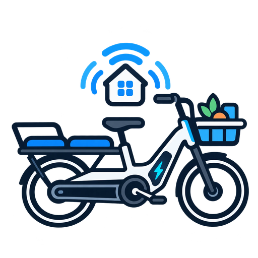

<p align="center"></p>

# TENWAYS BLE for Home Assistant — experimental
Unofficial HACS custom integration. The King Meter BLE protocol of the Longtail Duo is implemented in the [`tenways-ble`](https://github.com/Styx85/tenways-ble) library and verified byte-for-byte against an Android Bluetooth HCI capture of the official TENWAYS app. **Live operation in Home Assistant has not yet been confirmed on the bike.**

## Installation

Add this repository in HACS as a custom **Integration** repository. Install and restart Home Assistant. In Settings → Devices & services, add **TENWAYS BLE** and select the device advertised as **Longtail Duo**. Requires an HA Bluetooth adapter or an active-connection-capable ESPHome proxy within range. The companion TENWAYS app may block a concurrent BLE connection.

The bike advertises two endpoints. Only **Longtail Duo** (King Meter service) delivers bike data; HA offers it automatically and asks before adding it. The second endpoint `Tenways-ble-*` shows no useful values and is no longer offered; an existing entry for it can be deleted and stays deleted. It can still be added by hand for diagnostics.

## Exposed sensors

- Traction battery (%) from proprietary status field `0x0F`; previously observed 68%.
- Odometer (km, field `0x0C`), trip distance (km, field `0x09`), maximum and average ride speed (km/h), accumulated ride time (shown in hours).
  On the Longtail Duo these are lifetime counters: the trip values equal the odometer and keep counting until the trip is reset in the TENWAYS app (this integration never resets it). Odometer, trip distance and ride time are `total_increasing`, so HA's statistics give distance and riding hours per day, week or month.
- Current speed from field `0x06` (disabled by default; read 0 while parked, not yet confirmed while riding).
- Firmware (`2.20.16` observed; the app shows `1.4.0` elsewhere, so this may be another component) and serial number, read once per HA start.
- Light on/off (binary sensor) from field `0x11`, identified in HA (0 = off).
- Remaining range from field `0x0B` (`remainingRange` in the TENWAYS app). It reads 60, 54, 50, 45, 43 for assist levels 1–5 at 68 % and is not available at level 0, where the app also shows none. The unit is not stated in the app; km is probable.
- **Unverified:** power in W from field `0x23` (`power` in the app, values above 3000 ignored); 0 while parked, not yet seen while riding.
- Disabled diagnostic sensors for the raw status fields `0x0B`, `0x11`, `0x23`, `0x4F`; `0x4F` is not interpreted.
- Standard Bluetooth battery (`0x2A19`): **not the traction battery**; on the Longtail Duo it counts up by 1 roughly every read while the bike is on and resets to 0 when it is switched off, so it looks like a counter. Disabled diagnostic sensor.
- Last successful read (shows how old the kept values are), BLE signal, last advertisement and optional Device Information characteristics.

No unlock, light, power, firmware, configuration or pairing commands are implemented. The two recorded read requests (device info `0x04`, status `0x0B`) are sent via the `4348…0002` write characteristic on every poll; replies arrive through `4348…0003` notify, are reassembled if fragmented and must pass length and CRC-16/MODBUS checks. The only other thing ever sent is the clock sync of the **Set clock** button, and only when you press it. No spontaneous notifications were observed without a request.

## Limitations

- Sensor values should be considered experimental until confirmed live.
- Firmware changes may require updating the command/parser.
- The proprietary poll runs on any configured device exposing the King Meter service; other TENWAYS models are untested. Poll interval: five minutes by default, adjustable in the integration options (30–3600 s). Each poll opens a short BLE connection; the TENWAYS app cannot connect at the same time.
- Bluetooth proxies must support active GATT connections.
- HA only connects while the bike advertises (seen within the last 120 s). When it reappears after being off or out of range, HA polls immediately instead of waiting for the next interval. Whether the bike keeps advertising while switched off is not yet known.
- While the bike is off, out of range or a read fails, every sensor keeps its last read value, also across HA restarts; "Last successful read" says when it was read. Only current speed, light, remaining range, power and signal strength become unavailable.
- Live values (current speed, light, remaining range, power) lapse after two minutes without an advertisement instead of waiting for the next poll. "Last successful read" only moves when a valid reply arrived.
- The integration offers a diagnostics download (Bluetooth address and serial number redacted); attach it to bug reports.
- For bugs, enable debug logs for `custom_components.tenways` and submit a redacted excerpt. **Never publish a raw phone HCI log**; it may contain other devices' traffic and identifiers.

## Setting the bike's clock

The bike has no daylight saving and keeps showing summer time until it is set. The **Set clock** button (a configuration entity of the bike device) sends Home Assistant's local time to the bike, the same write the TENWAYS app makes. It sends nothing on its own; press it with the bike switched on and in range of an adapter or proxy, with the TENWAYS app closed. Press it again after each time change. **Not yet confirmed on a bike:** check the display after the first press. The frame matches a capture of the app byte for byte, but whether the bike takes local time as given and acknowledges it is still open; if the time is off, please report what the display shows.

## Distance per period and ride log

The **Odometer** is a `total_increasing` sensor, so Home Assistant keeps long-term statistics for it. A statistics graph shows the distance per day, week or month:

```yaml
type: statistics-graph
entities: [sensor.longtail_duo_odometer]
stat_types: [change]
period: week
chart_type: bar
```

Adjust the entity ID to yours. HA only sees the bike while it is in Bluetooth range, so a ride is counted when the bike is next seen at home, not while it is out.

For a **ride log in a calendar** (start, end, distance, duration, average speed, battery use) there is a ready-made blueprint in [stein155/tenways-bridge](https://github.com/stein155/tenways-bridge/blob/main/homeassistant/blueprints/automation/tenways_rides.yaml) (MIT). It works from the odometer and takes its inputs as entity selectors by device class, not by name. Pick this integration's **Odometer**, **Ride duration** and **Traction battery** sensors, a calendar (a local calendar works) and a text helper. We have not tried it with this integration yet; please report how it goes.

## Related projects

- **[tenways-bridge](https://github.com/stein155/tenways-bridge)** is an ESPHome firmware for an ESP32 that sits where the bike is parked, connects to the bike by itself and reports to Home Assistant. It supports more display types (Nordic UART and King Meter, including an encrypted session) and can switch the light. It lists the Longtail Duo as experimental and builds on our protocol notes. Choose it if you want a dedicated device and do not mind its firmware.
- **This integration** uses Home Assistant's own Bluetooth stack, so a standard ESPHome Bluetooth proxy with active connections is enough, and it only reads (no commands are sent to the bike).

Both are unofficial and not affiliated with TENWAYS.

## Development

```bash
pip install -r requirements_test.txt
pytest
```

Protocol details, test vectors and research notes live in [`tenways-ble`](https://github.com/Styx85/tenways-ble).

## Acknowledgements / Credits

Based on and inspired by [stein155/cgo600-bridge](https://github.com/stein155/cgo600-bridge), which provided valuable groundwork for understanding the proprietary TENWAYS telemetry protocol and its integration with Home Assistant.

Many thanks to the original author and contributors. That project has since become [tenways-bridge](https://github.com/stein155/tenways-bridge), whose protocol notes agree with our field names (both derive from the TENWAYS app).

The Longtail Duo implementation was developed using independently captured Bluetooth HCI traffic from the official TENWAYS app. It uses the King Meter BLE transport rather than the Nordic UART Service used by the CGO600 bridge.
