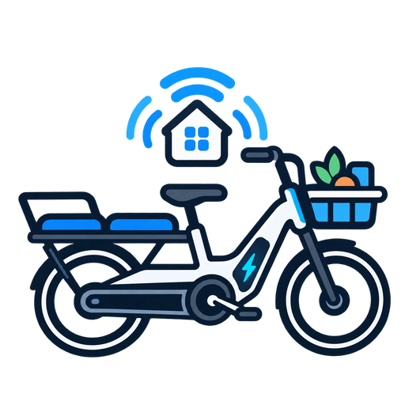

# TENWAYS BLE for Home Assistant — experimental

Unofficial integration for TENWAYS e-bikes over Bluetooth, built on the [`tenways-ble`](https://github.com/Styx85/tenways-ble) library. It reads the bike through Home Assistant's own Bluetooth stack: a local adapter or an ESPHome Bluetooth proxy with active connections. No cloud, no extra hardware. **Tested on a Longtail Duo** with Home Assistant 2026.11.

## Features

- **Battery and ride data:** traction battery, odometer, trip distance, ride time, maximum and average speed, light, remaining range.
- **Totals HA keeps for you:** total ride time, average and maximum speed over all trips, ride time and distance today. They keep counting when the trip is cleared, are stored per bike and appear in the long-term statistics.
- **Two buttons:** **Set clock** (the bike has no daylight saving) and **Reset trip**. Each sends the TENWAYS app's own write, only when pressed.
- Keeps the last values while the bike is off, also across restarts; polls immediately when the bike is switched on.
- Diagnostics download with the address and serial number redacted.

No unlock, light, firmware or configuration commands. Details on every entity, where its value comes from and how far it is confirmed: [docs/entities.md](docs/entities.md).

## Supported bikes

| Bike (advertised name) | Status |
|---|---|
| Longtail Duo | **tested**, all features |
| CGO009_D | probably works: the TENWAYS app uses the same driver as for the Longtail Duo |
| CGO009, AGO, AGO X, AGO T, CARGO | possibly: same King Meter protocol in the app, untested. If HA does not discover the bike, add it by its Bluetooth address |
| CGO800 | not yet: King Meter with the checksum in the other byte order |
| AGO AIR, Wayfarer | no: encrypted session |
| CGO600, CGO600_D | no: different protocol (Nordic UART, `0x57` frames) |

How the app picks a driver per model: [docs/models.md](docs/models.md). Tried another model? Please open an issue with a diagnostics download.

## Installation

1. HACS → ⋮ → Custom repositories → add `https://github.com/Styx85/ha-tenways` as **Integration**.
2. Install **TENWAYS BLE** and restart Home Assistant.
3. Switch the bike on. Settings → Devices & services: HA offers the bike (advertised as **Longtail Duo**); confirm it. Otherwise add **TENWAYS BLE** and pick it or type its Bluetooth address.

Close the TENWAYS app: the bike accepts one connection at a time.

## Options

Settings → Devices & services → TENWAYS → Configure:

- **Poll interval:** 300 s by default (30–3600 s). Each poll is a short BLE connection.
- **Ride time before HA counted:** hours ridden before the trip was first cleared, so that the total ride time and the overall average are right.

## Automation hints

- **Set the clock after a daylight saving change** or every 90 days, after the first successful read of the day: [example](docs/automations.md#example-set-the-clock-automatically).
- **A fresh trip every day** on the display, cleared after the first successful read of the day: [example](docs/automations.md#example-a-fresh-trip-every-day).
- Distance per week as a statistics graph, and a ride log in a calendar: [docs/automations.md](docs/automations.md#distance-per-period-and-ride-log).

## Limitations

- HA only reads the bike while it is switched on and in Bluetooth range; a ride counts when the bike is next seen at home.
- Current speed and power have not yet been checked while riding.
- More on polling, kept values, Bluetooth proxies and bug reports: [docs/how-it-works.md](docs/how-it-works.md).

## Documentation

- [Entities](docs/entities.md) · [Automations and dashboards](docs/automations.md) · [Supported models](docs/models.md) · [How it works, limitations and troubleshooting](docs/how-it-works.md)
- Protocol, test vectors and research notes: [tenways-ble](https://github.com/Styx85/tenways-ble)

## Acknowledgements / Credits

Based on and inspired by [stein155/cgo600-bridge](https://github.com/stein155/cgo600-bridge), which provided valuable groundwork for understanding the proprietary TENWAYS telemetry protocol and its integration with Home Assistant.

Many thanks to the original author and contributors. That project has since become [tenways-bridge](https://github.com/stein155/tenways-bridge), whose protocol notes agree with our field names (both derive from the TENWAYS app).

The Longtail Duo implementation was developed using independently captured Bluetooth HCI traffic from the official TENWAYS app. It uses the King Meter BLE transport rather than the Nordic UART Service used by the CGO600 bridge.

Unofficial; not affiliated with TENWAYS.
