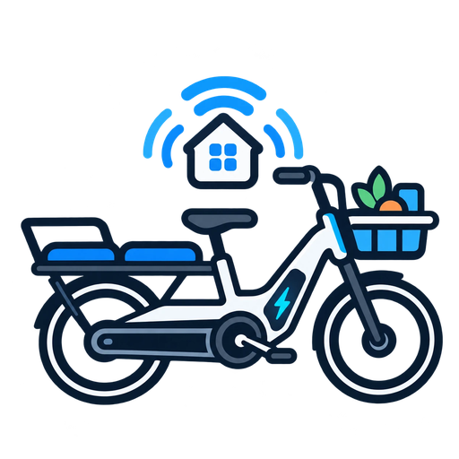

<p align="center"></p>

# TENWAYS BLE for Home Assistant — experimental
Unofficial HACS custom integration. The King Meter BLE protocol of the Longtail Duo is implemented in the [`tenways-ble`](https://github.com/Styx85/tenways-ble) library and verified byte-for-byte against an Android Bluetooth HCI capture of the official TENWAYS app. **Live operation in Home Assistant has not yet been confirmed on the bike.**

## Installation

Add this repository in HACS as a custom **Integration** repository. Install and restart Home Assistant. In Settings → Devices & services, add **TENWAYS BLE** and select the device advertised as **Longtail Duo**. Requires an HA Bluetooth adapter or an active-connection-capable ESPHome proxy within range. The companion TENWAYS app may block a concurrent BLE connection.

If v0.2 was already installed against `Tenways-ble-400A59`, **do not expect the new traction sensors on that old entry**. Add the separately advertised **Longtail Duo** device. Both can remain installed for diagnostics.

## Exposed sensors

- Traction battery (%) from proprietary status field `0x0F`; previously observed 68%.
- Odometer (km), trip distance (km), maximum and average ride speed (km/h), accumulated ride time (seconds).
- Current speed from field `0x06` (disabled by default; read 0 while parked, not yet confirmed while riding).
- Firmware (`2.20.16` observed; the app shows `1.4.0` elsewhere, so this may be another component) and serial number, read once per HA start.
- Disabled diagnostic sensors for status fields with unknown meaning: `0x0B`, `0x11`, `0x23`, `0x4F`.
- Standard Bluetooth battery (`0x2A19`): **not the traction battery**; may read 100% or 1% on the two BLE endpoints.
- BLE signal, last advertisement, last successful read and optional Device Information characteristics.

No unlock, light, power, firmware, configuration or pairing commands are implemented. Only the two recorded read requests (device info `0x04`, status `0x0B`) are sent via the `4348…0002` write characteristic; replies arrive through `4348…0003` notify, are reassembled if fragmented and must pass length and CRC-16/MODBUS checks. The clock sync the app performs is deliberately not sent. No spontaneous notifications were observed without a request.

## Limitations

- Sensor values should be considered experimental until confirmed live.
- Firmware changes may require updating the command/parser. A failed read yields unavailable readings rather than reusing old telemetry.
- The proprietary poll runs on any configured device exposing the King Meter service; other TENWAYS models are untested. Poll interval: five minutes by default, adjustable in the integration options (30–3600 s). Each poll opens a short BLE connection; the TENWAYS app cannot connect at the same time.
- Bluetooth proxies must support active GATT connections.
- HA only connects while the bike advertises (seen within the last 120 s). When it reappears after being off or out of range, HA polls immediately instead of waiting for the next interval. Whether the bike keeps advertising while switched off is not yet known.
- While the bike is unreachable, totals (odometer, trip, ride time, max/average speed) keep their last read value; traction battery, current speed and raw fields become unavailable. Totals are kept in memory only and are empty again after an HA restart until the next successful read.
- For bugs, enable debug logs for `custom_components.tenways` and submit a redacted excerpt. **Never publish a raw phone HCI log**; it may contain other devices' traffic and identifiers.

## Development

```bash
pip install -r requirements_test.txt
pytest
```

Protocol details, test vectors and research notes live in [`tenways-ble`](https://github.com/Styx85/tenways-ble).

## Acknowledgements / Credits

Based on and inspired by [stein155/cgo600-bridge](https://github.com/stein155/cgo600-bridge), which provided valuable groundwork for understanding the proprietary TENWAYS telemetry protocol and its integration with Home Assistant.

Many thanks to the original author and contributors.

The Longtail Duo implementation was developed using independently captured Bluetooth HCI traffic from the official TENWAYS app. It uses the King Meter BLE transport rather than the Nordic UART Service used by the CGO600 bridge.
